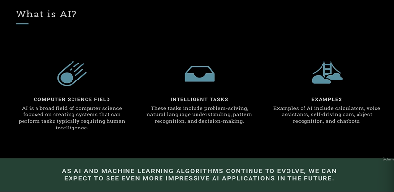
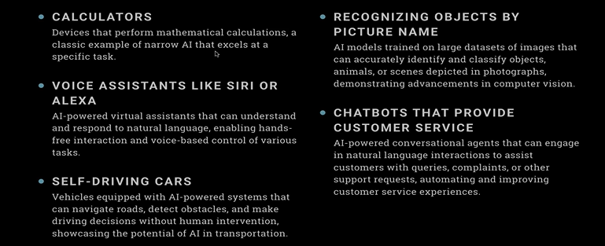
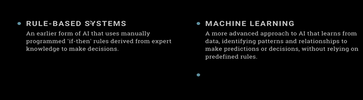
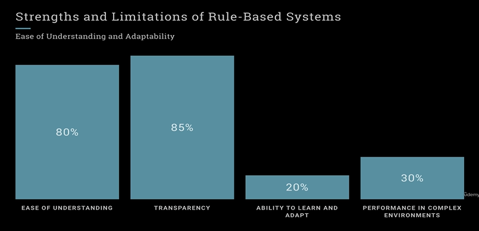
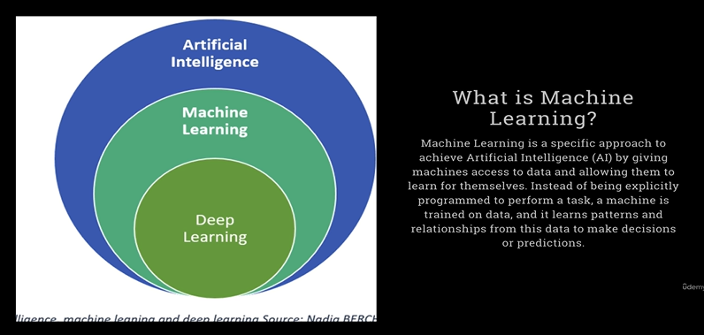
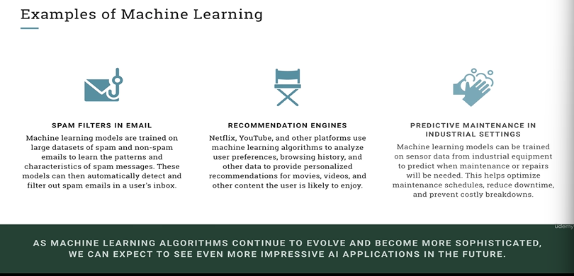
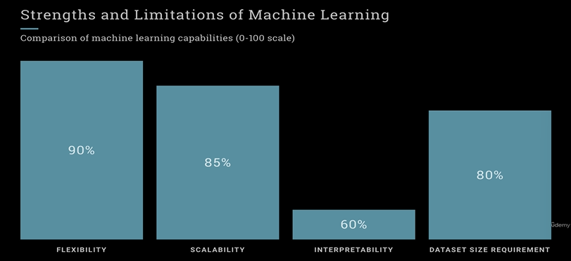
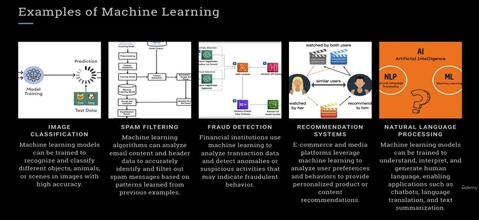
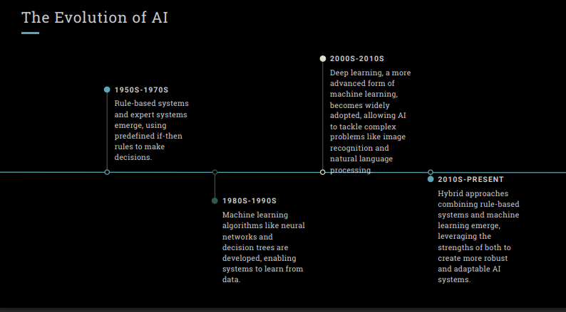
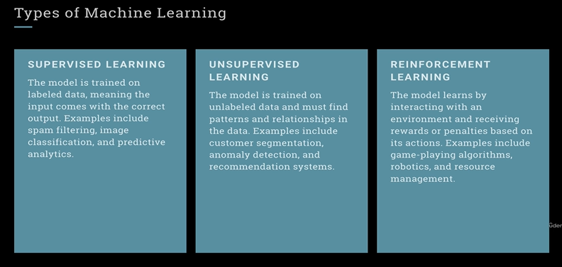

# Getting started with Machine Learning Testing Basics

## Agenda

## Course Outcome

## What is AI?

## Examples of AI

## The Approaches of AI

## Strengths and Limitations of Rule-Based Systems

## What is Machine Learning

* Machine learning is one of the way to achieve Artificial Intelligence
    * You give the data and write algorithms using different python library

## Examples of Machine Learning

> Target ads people get(YouTube, Netflix) based on Machine learning

## Strengths and Limitations of Machine Learning

> You need to give lot of dataset.  
> The way it gives answers is unknown. Because Model itself is learning.  

## Examples of Commonly used Machine Learning Models and their usage

Input -> ChatGPT -> Output

Gemini, Copilot  

## Types of Machine Learning

> We will see how QA is involved in Machine learning model development

