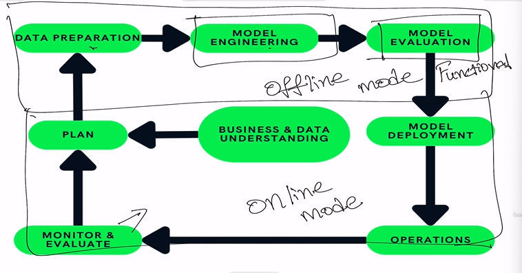

# Early Testing Strategies in ML Model Engineering phase (Supervised Learning)

## Understand Machine Learning Model Life cycle stages with online/offline modes

##  How Machine Learning models works in nutshell -Learn terminologies used

