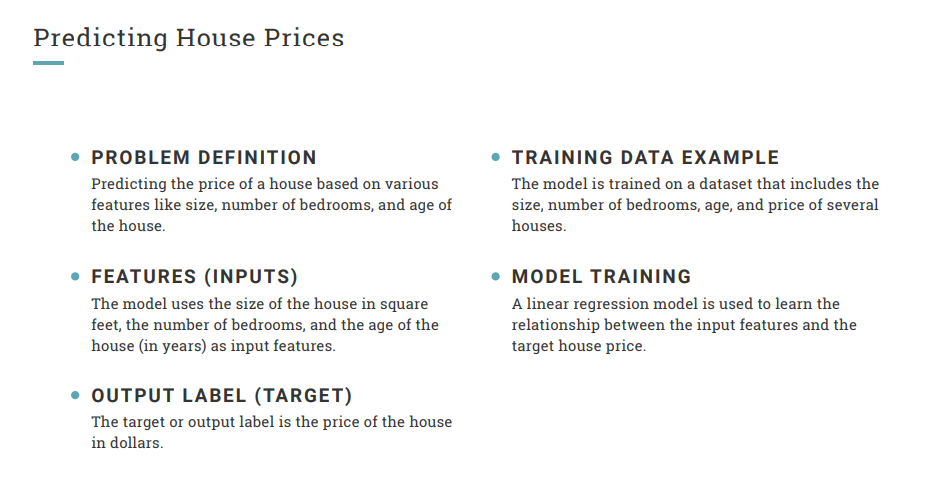
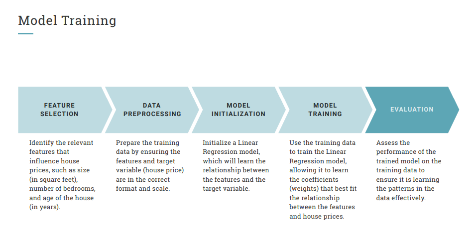
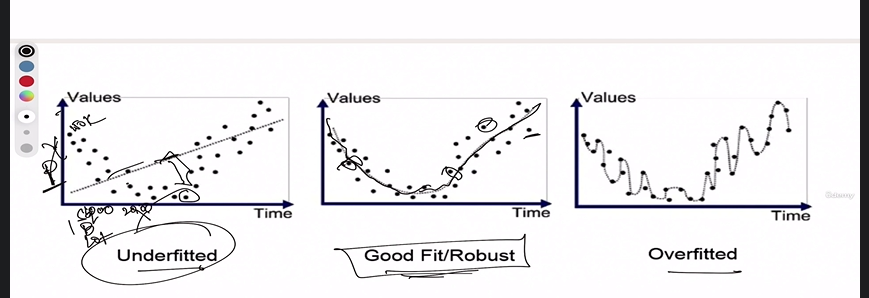

# Early Testing Strategies in ML Model Engineering phase (Supervised Learning)


## Understand Machine Learning Model Life cycle stages with online/offline modes


##  How Machine Learning models works in nutshell -Learn terminologies used


1. **Two modes:** Offline mode (data preparation, model training, validation and testing before production) and Online mode (model serving in production).

2. **ML Fundamentals:** A model learns patterns from historical data using ML algorithms instead of relying entirely on manually coded rules. It uses learned patterns to predict outputs for new, unseen inputs.

3. **Training Phase:** Feed valid, representative data to the model. ML algorithms identify patterns and learn relationships between inputs and outputs. Example: House price prediction using square footage, bedrooms, plot size and location.

4. **Features (X):** Input variables provided to the model (e.g., square footage, bedrooms, location).

5. **Label (Y):** Expected output (e.g., house price).

6. **Training Data:** Dataset containing features and their corresponding labels, used to train the model.

7. **Validation Data:** Separate dataset used to evaluate model predictions and tune the model. Inputs are provided without labels during prediction; actual labels are used for comparison.

8. **Two common ML problems:** Overfitting and Underfitting, which affect the model's ability to generalize to unseen data.






## Understand how OverFitting Testng & UnderFitting works with Trained data sets

Underfitting, Good Fit & Overfitting  

1. **Underfitting:** Model is insufficiently trained and cannot identify patterns properly. Predictions on unseen data are inaccurate. Occurs during initial training iterations when insufficient data or poor algorithms are used.

2. **Good Fit:** Model learns the underlying patterns and produces predictions close to actual values. It performs well on both training and unseen data. This is the desired state before production.

3. **Overfitting:** Model learns training data too closely, including unnecessary details and noise. It performs very well on training data but poorly on unseen data. Excessive features or model complexity can cause overfitting.

4. **Example:** In house price prediction, relevant features include square footage, bedrooms, plot size and location. Adding unnecessary features like house colour or street name may complicate the model.

5. **QA Role:** Perform validation testing at every training iteration. Monitor prediction accuracy, identify underfitting/overfitting and communicate performance degradation to developers.

**Key takeaway:** The goal is to achieve a good fit so the model generalizes well to unseen data. QA can evaluate ML behaviour through black-box testing without understanding internal algorithms.




```txt
So as a QA you need not go inside the code based on the data you have.

You can keep testing your ML blindly as a black box.

Okay, don't worry about what is happening inside.

They will give you the software, keep testing it and see how the values or how the accuracy is going

down or going up, or it is fitting there.

That's where you will actively involved in this engineering phase.
```