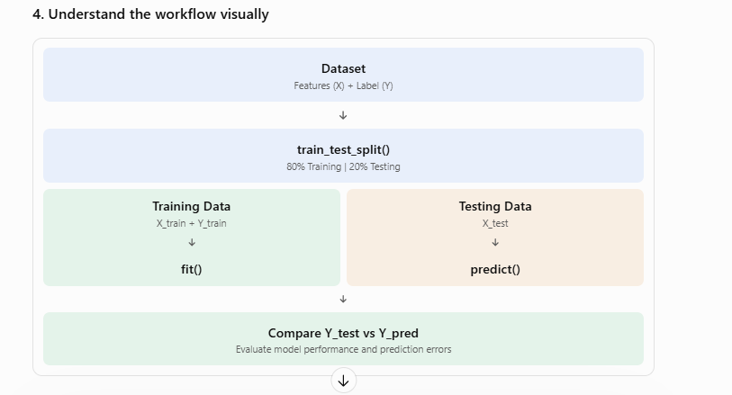

* simple Python implementation of the House Price Prediction using Linear Regression demonstrated

The code covers:

1. Creating a dataset.
2. Separating features (X) and labels (Y).
3. Splitting training and testing data.
4. Training using `fit()`.
5. Predicting using `predict()`.
6. Comparing actual vs predicted values.
7. Visualizing results using Matplotlib.

## 1. Install required libraries

```
pip install pandas numpy scikit-learn matplotlib
```

## 2. Complete Python code

```

import pandas as pd
import matplotlib.pyplot as plt

from sklearn.model_selection import train_test_split
from sklearn.linear_model import LinearRegression
from sklearn.metrics import mean_absolute_error, r2_score

# STEP 1: Create sample dataset
data = {
    "Square_Feet": [1000, 1200, 1500, 1800, 2000,
                    2200, 2500, 2800, 3000, 3200],
    "Bedrooms": [2, 2, 3, 3, 4, 4, 4, 5, 5, 5],
    "House_Age": [5, 10, 8, 6, 4, 3, 5, 2, 1, 3],
    "Price": [150000, 180000, 220000, 260000, 300000,
              320000, 350000, 400000, 430000, 450000]
}

df = pd.DataFrame(data)

# STEP 2: Separate Features (X) and Label (Y)
X = df[["Square_Feet", "Bedrooms", "House_Age"]]
Y = df["Price"]

# STEP 3: Split dataset
X_train, X_test, Y_train, Y_test = train_test_split(
    X, Y, test_size=0.2, random_state=42
)

# STEP 4: Create Linear Regression model
model = LinearRegression()

# STEP 5: Train the model
model.fit(X_train, Y_train)

# STEP 6: Predict using test data
Y_pred = model.predict(X_test)

# STEP 7: Compare actual vs predicted
results = pd.DataFrame({
    "Actual_Price": Y_test.values,
    "Predicted_Price": Y_pred
})

print(results)

# STEP 8: Evaluate model
print("Mean Absolute Error:",
      mean_absolute_error(Y_test, Y_pred))

print("R2 Score:", r2_score(Y_test, Y_pred))

# STEP 9: Visualize actual vs predicted
plt.scatter(Y_test, Y_pred)

plt.xlabel("Actual House Price")
plt.ylabel("Predicted House Price")
plt.title("Actual vs Predicted House Prices")

# Ideal prediction line
plt.plot(
    [Y_test.min(), Y_test.max()],
    [Y_test.min(), Y_test.max()]
)

plt.show()

```

## 3. Understand the important methods

| Method                  | Purpose                                                          |
| ----------------------- | ---------------------------------------------------------------- |
| `train_test_split()`    | Splits dataset into training and testing sets                    |
| `LinearRegression()`    | Creates the ML model                                             |
| `fit(X_train, Y_train)` | Trains the model                                                 |
| `predict(X_test)`       | Predicts outputs for unseen inputs                               |
| `mean_absolute_error()` | Measures average prediction error                                |
| `r2_score()`            | Measures how well the model explains variations in actual values |
| `plt.scatter()`         | Plots actual vs predicted values                                 |

## 4. Understand the workflow visually



## 5. Important concepts from a QA perspective

When testing an ML model, consider:

- Functional testing: Does the model generate predictions for valid inputs?
- Input validation: What happens with missing values, negative square footage or invalid bedroom counts?
- Prediction correctness: How close are predicted prices to actual prices?
- Generalization: Does the model perform well on unseen data?
- Overfitting/Underfitting: Compare training and testing performance, not just one graph.
- Data quality: Are training records representative and accurate?

One important distinction: The sample code demonstrates the basic training and prediction workflow. It does not independently establish that the model is a good fit. For that, evaluate training and test performance and use suitable validation techniques.

My suggestion: Run this code in Jupyter Notebook and understand each step, especially `fit()`, `predict()`, `X_train`, `X_test`, `Y_train` and `Y_test`. These are foundational concepts for AI/ML testing.