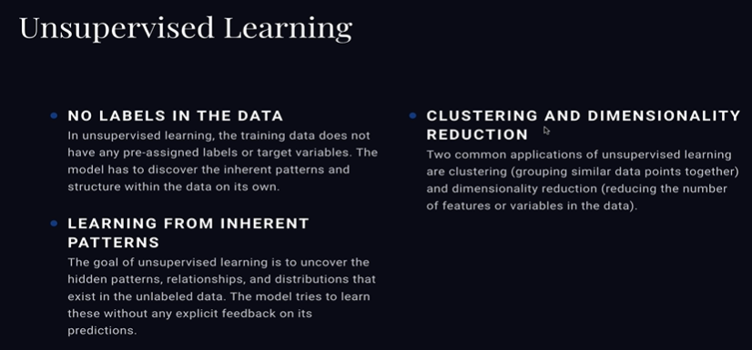
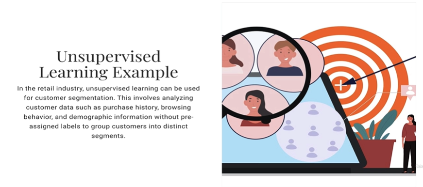
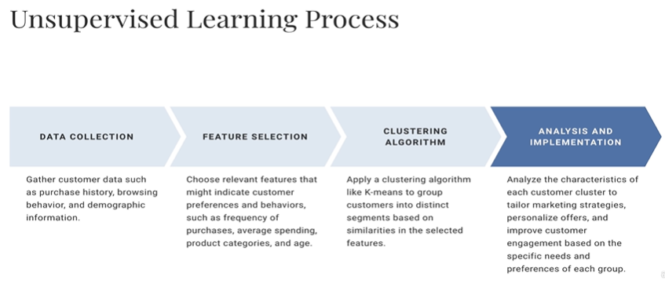
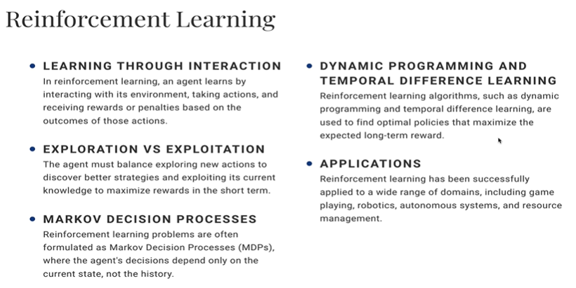
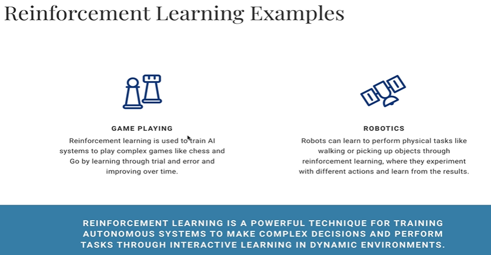
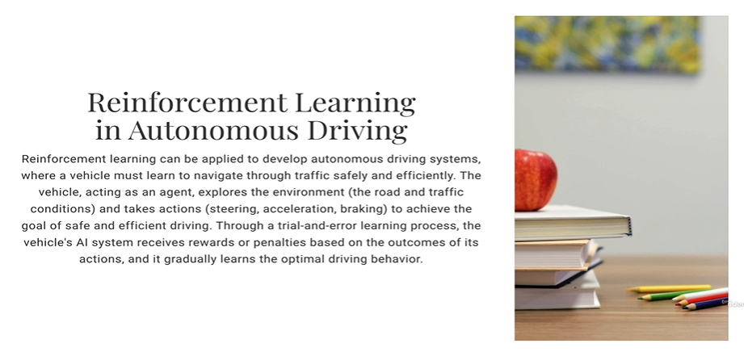
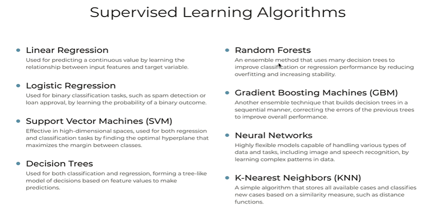
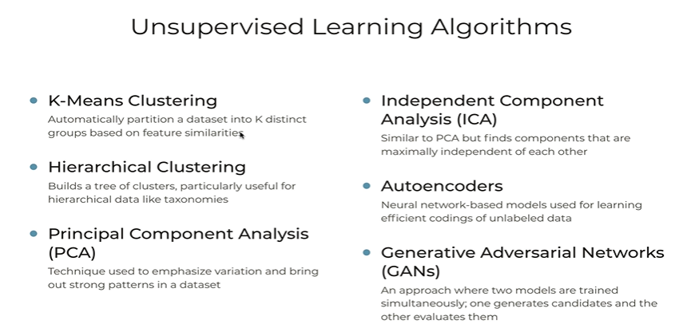
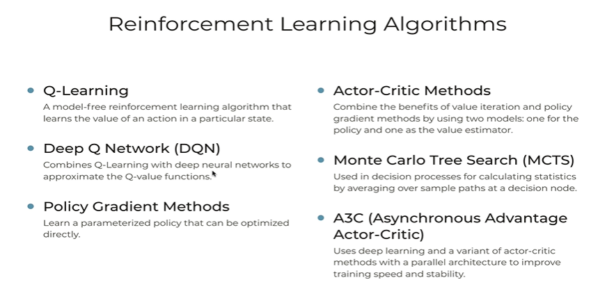
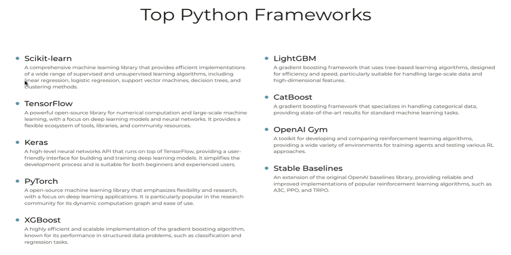

# Reinforcement Learning & Commonly used frameworks and Algos in ML Models

## Introduction to Reinforcement Learning in ML Model with examples

## Reinforcement Learning

> Realtime decisions are taken based on situation outside

## Algorithms and Frameworks commonly used in developing ML Models

* **Supervised Learning Algorithms**

* **Unsupervised Learning Algorithms**

* **Reinforcement Learning Algorithms**

* Top python Algorithms

