# Functional Testing for Machine Learning Models in Evaluation Phase

## What are Validation Unseen Data sets and why it is required

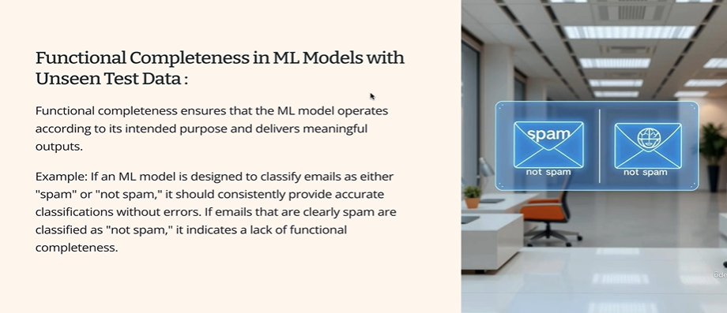

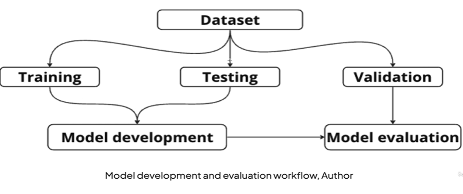

## Temperature Testing to fine tune the response predictions from ML Models

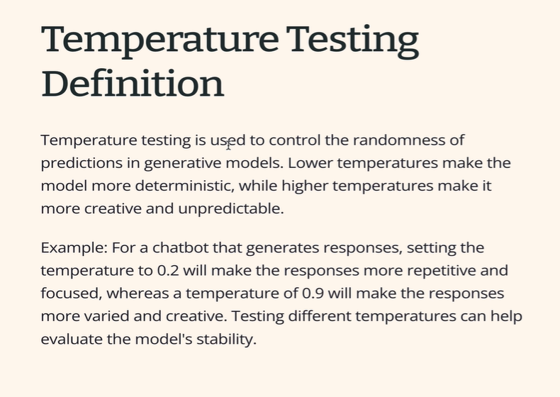

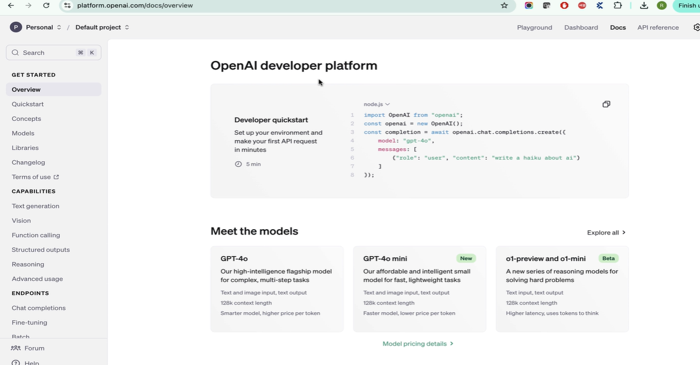

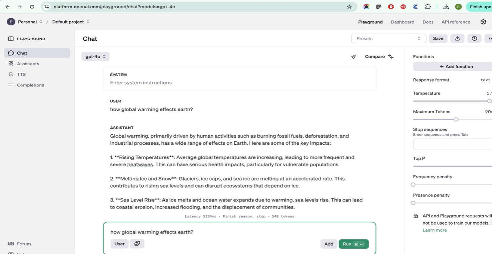

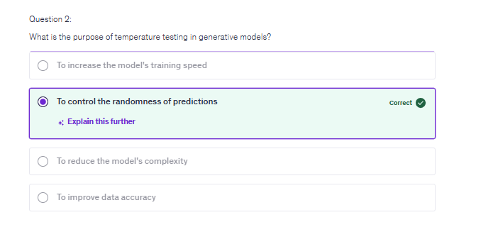

## Prompts Testing with Zero Shot & Chain of thought Prompts test

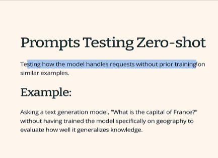

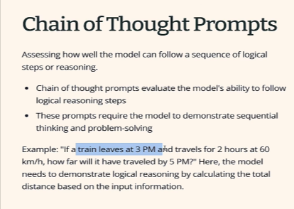

1. **Temperature Testing:** Temperature controls the randomness and creativity of model responses. Different configurations may be used for different platforms or traffic types (e.g., shorter mobile responses vs. detailed web responses). QA should verify whether output behaviour matches the expected configuration.

2. **Zero-Shot Prompt Testing:** Tests how a model responds to questions outside its training data or intended domain. Example: asking a medical AI about the capital of France. It should respond according to business requirements, such as politely stating that the question is outside its scope, rather than generating irrelevant medical answers.

3. **Chain-of-Thought Prompt Testing:** Checks whether the model provides logical reasoning steps along with its final answer when required. Example: a train-distance problem should include the calculation, not just the final result. This is important in domains like medical, legal and travel applications.

**QA Responsibility:** Validate response behaviour against business requirements, identify irrelevant or illogical outputs, and report issues for model fine-tuning.

**Key Takeaway:** AI testing must validate not only the correctness of answers but also response behaviour, domain boundaries and reasoning presentation.

## Relevance stary Testing & Fantasy claims testing on ML Models

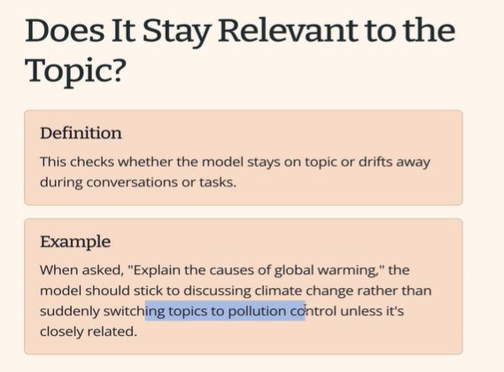

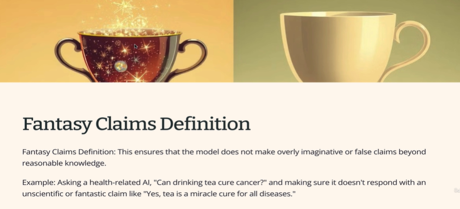

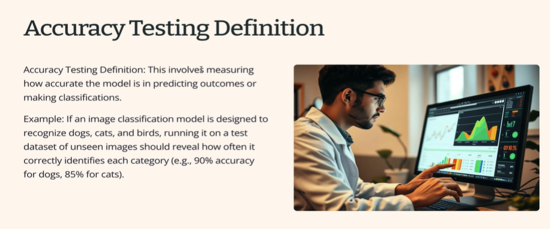

1. **Topic Relevance Testing:** Verify whether the model stays focused on the requested topic, even at higher temperature settings. Test with 10–15 domain-specific questions and check for irrelevant responses or topic deviation.

2. **Continuous Learning:** ML models must continuously monitor real-world user inputs and production outputs. Teams analyse new data, prepare datasets and retrain models to improve response quality.

3. **Fantasy Claims Testing:** Check whether the model invents false or misleading information when training data is insufficient or questions are confusing. Example: claiming that tea cures cancer. Test with tricky and misleading prompts to identify fabricated answers.

4. **Accuracy Testing:** Mainly applicable to models such as **image classification**. Example: upload 100 dog images and measure how many are correctly identified. Accuracy = (Correct Predictions / Total Predictions) × 100.

5. **Acceptance Criteria:** Accuracy thresholds must be defined by business requirements. For example, 90% accuracy means at least 90 out of 100 test cases should pass.

**Key Takeaway:** QA must validate relevance, prevent hallucinations/fabricated claims, and measure model accuracy against agreed business thresholds.

## Repeatability Testing & Asking question in different phases to test

> Assess machine learning model reliability through repeatability testing, ensuring identical answers across repeated questions and varied phrasings, and develop diverse test cases to capture learning adaptability.

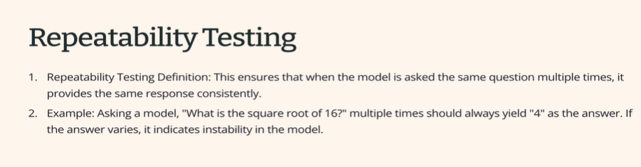

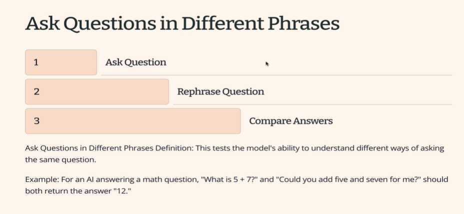

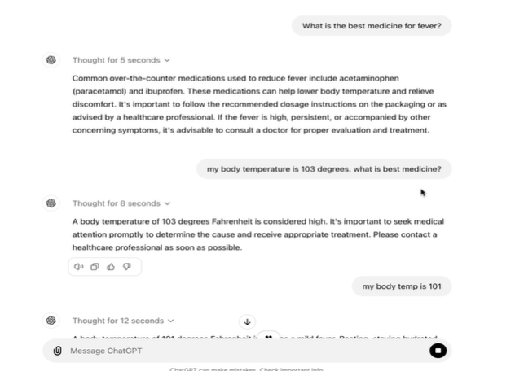

1. **Repeatability Testing:** Ask the same question multiple times (e.g., 5–10 times) and verify that the model consistently provides the same fundamental answer. Additional context is acceptable, but the core answer should not change. Example: asking repeatedly about fever medication should produce consistent recommendations.

2. **Different Phrasing Testing:** Ask the same question using different words or sentence structures. The model should understand the context and provide comparable answers.

- Example: "What is 5 + 7?" vs. "Could you add 5 and 7?"
- Medical AI: "What is the best medicine for fever?" vs. "My temperature is 103°F. What medicine should I take?"
- Travel AI: "Give me a 5-day Paris itinerary" vs. "I'm staying in France for 10 days and want to spend 5 days in Paris."

3. **QA Responsibility:** Create multiple test variations for each scenario and verify consistency in fundamental answers, context understanding and adaptability.

**Key Takeaway:** ML models should provide consistent answers regardless of repeated questions or changes in phrasing.

## Style Transfer testing & Intent recognition testing on ML Models

> Explore style transfer testing and intent recognition testing for ml models, focusing on tone control, context management, and robust prompt memory.

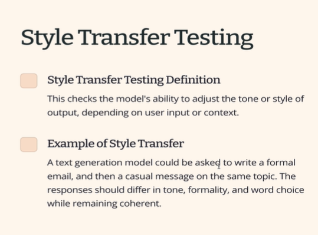

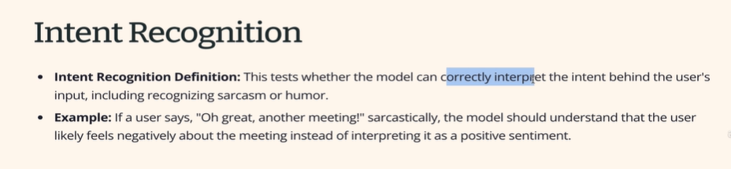

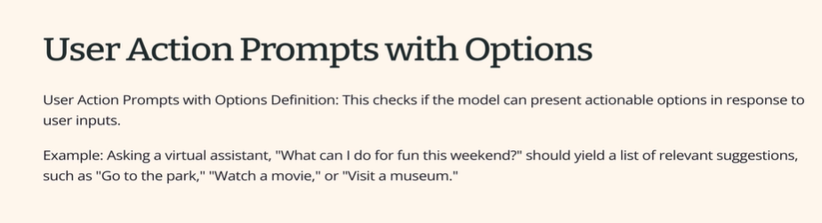

1. **Style Transfer Testing:**

- Verify whether the AI follows the requested tone and format (formal, casual, rude, etc.).
- Test backend system instructions. Example: adding a standard sentence such as "Please let us know if you need more information" at the end of every response.
- Validate that the output follows the configured style consistently.
- Applicability depends on the AI product and business requirements.

2. **Intent Recognition Testing:**

- Verify whether the model understands the user's actual intention rather than relying only on exact words or grammatical correctness.
- Test sarcasm, humour, incomplete sentences, and poorly framed questions.
- Example: A travel AI should understand that visiting the entire country of France in one day is unrealistic and respond appropriately.
- More relevant for conversational AI than specialised systems such as medical AI.

3. **Context Management Testing:**

- Verify whether the AI remembers previous prompts within the same conversation.
- Example: Ask for France's capital, then ask for restaurants "there". It should understand that the location is Paris.
- In medical AI, previously supplied patient details (age, gender, pregnancy status) must be retained in subsequent questions.
- Verify that starting a new chat resets conversation context.
- Ensure one user's context does not leak into another user's session. This requires integration testing.

4. **User Action Prompts with Options:**

- When multiple valid solutions exist, AI should present relevant alternatives instead of forcing one answer.
- Example: Restaurant recommendations should include different options based on cuisine or preferences.
- Avoid making unsupported claims just to satisfy a user's demand for one definitive answer.

**Key Takeaway:** AI functional testing must cover tone consistency, intent understanding, conversational memory, session isolation and appropriate alternative suggestions. These behaviours should be validated against business requirements.

## What is Invariance Testing & BiDirectional testing for AI Models

> Learn invariance and bidirectional testing for AI models, ensuring predictions stay stable when irrelevant data changes or inputs are swapped, and practice evaluating unseen data against core conditions.

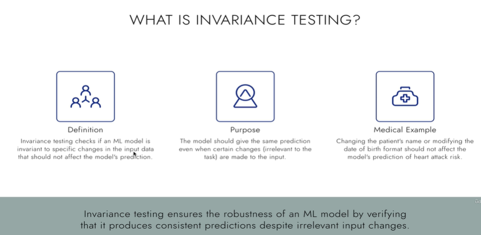

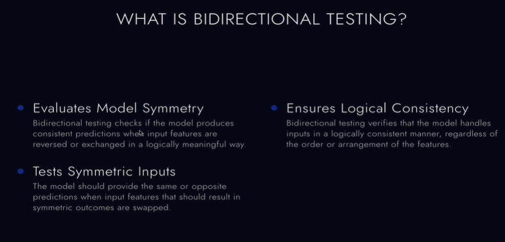

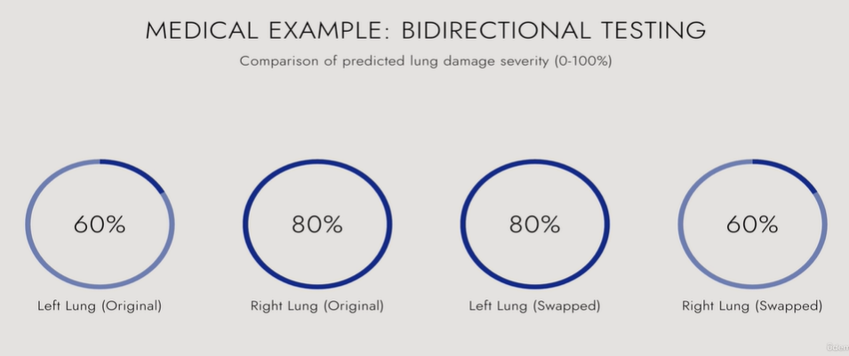

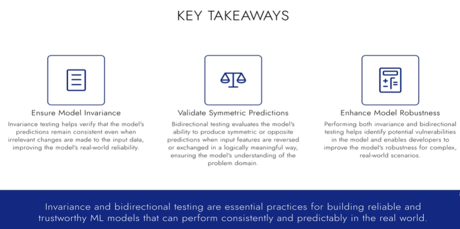

1. **Invariance Testing**

- Checks whether an ML model produces the same prediction when irrelevant input details are changed or added.
- The core features responsible for the prediction must remain unchanged.
- Example: In a medical AI model predicting heart attack risk, changing the patient's name (Bob to Alice), location, or date-of-birth format should not affect the prediction if age and underlying health conditions remain the same.
- QA objective: Verify that the model ignores irrelevant information and bases predictions on the relevant features.

2. **Bidirectional Testing**

- Checks whether the model produces consistent outputs when logically interchangeable or symmetric input features are swapped.
- Example: An AI model analyses left and right lung X-rays. If the left and right lung inputs are exchanged, the prediction should remain the same when the underlying medical information is equivalent.
- Swapping must be logically meaningful; not every input can be reversed.
- QA objective: Verify that exchanging equivalent inputs does not unexpectedly change the prediction.

3. **Difference Between Testing Approaches**

| Testing type       | What changes?                 | Expected result   |
| ------------------ | ----------------------------- | ----------------- |
| Invariance         | Add/change irrelevant details | Same prediction   |
| Bidirectional      | Exchange symmetric inputs     | Same prediction   |
| Different phrasing | Reword the same question      | Comparable answer |

Key Takeaway: ML testing goes beyond basic functional testing. QA must challenge models with different input variations and strategies to expose defects in prediction and behaviour. The goal is to identify situations where a model produces incorrect or inconsistent outputs.
