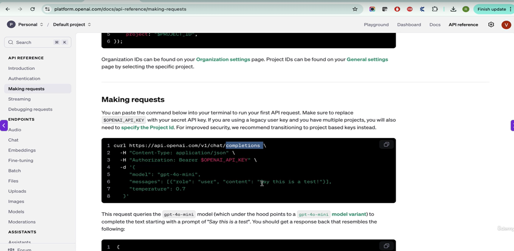
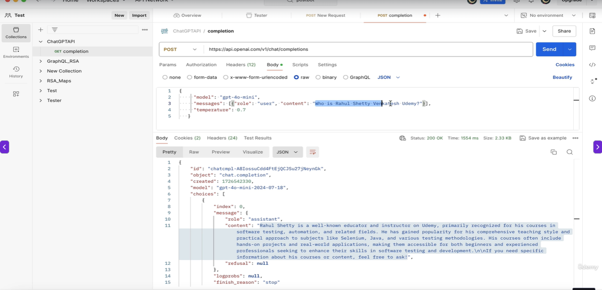
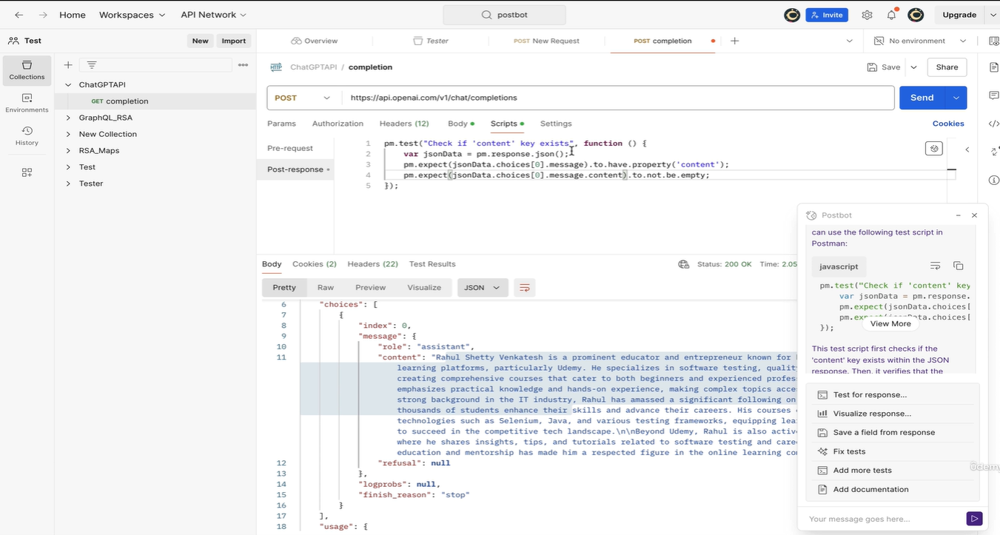

# Introduction to API testing on Machine Learning Models

## Create OpenAI Account to test ChatGPT API's of generating response

> API Testing of Machine Learning Models

1. **How API Integration Works**

- Users interact with an ML model through the UI.
- The UI sends user input to the API server, which routes it to the appropriate endpoint.
- Requests may be placed in a queue when multiple requests arrive.
- The ML server processes the input using model algorithms and associated data, generates a response, and sends it back through the API to the UI.

2. **Why API Testing Is Important**

- Integration testing: Verifies communication between the UI and API, including correct data formats and encoding.
- Automation: Allows QA to automate ML test scenarios directly through API endpoints instead of repeatedly interacting with the UI.
- API testing is generally less costly than automating every scenario through the UI using Selenium or Playwright.

3. **API Testing of ML Models**

- Every ML product can expose API endpoints to accept input and return predictions or responses.
- QA can send test questions directly to these endpoints and validate the returned content.
- API requests may include:
  - Endpoint URL
  - Headers and request body
  - Model/version selection
  - Input prompt and temperature
  - Authorization API key
- Responses may contain generated content, model information, role and token usage.

4. **Automation Approach**

- Identify 20–30 important ML test scenarios.
- Convert them into API requests and automate their execution.
- Extract response content and compare it against expected behaviour.
- UI automation can still be used when validating frontend-specific functionality.

**Key Takeaway:** API testing enables faster and more efficient automation of ML model scenarios. Instead of relying only on UI-based testing, QA can directly test model endpoints, validate responses and repeatedly execute important test cases.

Link - https://developers.openai.com/api/docs/quickstart

## Download Postman tool to setup ChatGPT APIs environment for testing

> Download and set up Postman tool to hit ChatGPT API endpoints and observe responses. Build and run API tests for machine learning models in minutes using headers, payloads, and keys.

* It will be a POST method as you are sending question
* get the API key 

1. **Postman Setup**

- Postman is a tool for sending API requests, validating responses and creating automated tests.
- Create a Collection (like a test suite/folder) and add API requests inside it.
- For ML model testing, the primary endpoint is generally the completion endpoint, where questions are submitted and responses are generated.

2. **Making an API Request**

- HTTP Method: POST, because the question is sent as a request payload.
- Endpoint: Obtain the API endpoint from the developer or API documentation.
- Headers:
  - `Authorization: Bearer <API_KEY>` for secure access.
  - `Content-Type: application/json` for JSON data.
- Body: Select raw JSON and provide the prompt, model and temperature.
- Send the request and inspect the generated response.

3. **Automating ML Test Scenarios**
API testing can automate previously discussed ML testing types, including:

- Repeatability and different phrasing.
- Invariance and bidirectional testing.
- Accuracy, fantasy claims and chain-of-thought behaviour.
- Out-of-scope questions and expected fallback responses.

4. **QA Assertions and Validation**

- Validate requirements rather than expecting identical generated content every time.
- Example: Check whether the response stays below 200 or 500 words as requested.
- Test different temperature settings (e.g., 0.1 and 0.5).
- For unsupported questions, verify that the model responds appropriately, such as indicating uncertainty.
- Use parameterized test data, Java DataProviders or Cucumber Scenario Outlines to execute multiple inputs.

**Key Takeaway:** Postman allows QA to test and automate ML model behaviour directly through APIs. Focus on validating requirements, response constraints and edge cases rather than exact response text, which may vary between requests.

## PostBot plugin to generate automation scripts for API responses in Postman

> Learn to automate API testing in Postman using Post Bot to generate scripts, validate JSON responses, ensure content exists and is under 200 words, and implement automated test cases.

1. **Postman Scripts & Post Bot**

- Postman provides a Post-response scripting section to validate API responses automatically.
- Beginners can use Post Bot to generate test scripts using natural-language instructions.
- Example: Ask Post Bot to verify whether the JSON response contains a `content` property and whether it is non-empty.

2. **Creating Automated Assertions**

- Example functional requirement: ML response must contain fewer than 200 words.
- Extract the content from the JSON response, split it by spaces and count the words.
- Add an assertion to check whether the word count is below 200.
- Postman displays the result as PASS or FAIL under Test Results.
- If the requirement changes, update the assertion accordingly.

3. **Understanding Response Extraction**

- `pm.response` provides access to the API response.
- `pm.response.json()` extracts the JSON response.
- Navigate through `choices[0] → message → content` to access generated text.
- Store the content in a variable and apply validations.

4. **What Should QA Automate?**

- Avoid validating exact generated sentences because ML responses are dynamic.
- Focus on stable, requirement-based checks:
  - Word-count limits and boundaries.
  - Required keywords and expected phrases.
  - Formal or informal tone indicators.
  - Context management.
  - Different phrasings of the same question.
- Parameterize test inputs to execute multiple scenarios.

**Key Takeaway:** Effective ML API automation focuses on specific requirements, edge cases and measurable assertions rather than exact text matching. Tests should remain stable even when generated responses change.

> Self-Reminder - *Learn API Testing*