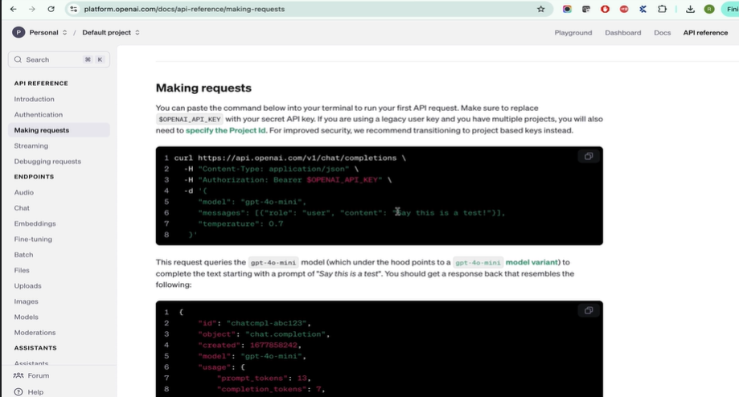

# Introduction to API testing on Machine Learning Models

## Create OpenAI Account to test ChatGPT API's of generating response

> API Testing of Machine Learning Models

1. **How API Integration Works**

- Users interact with an ML model through the UI.
- The UI sends user input to the API server, which routes it to the appropriate endpoint.
- Requests may be placed in a queue when multiple requests arrive.
- The ML server processes the input using model algorithms and associated data, generates a response, and sends it back through the API to the UI.

2. **Why API Testing Is Important**

- Integration testing: Verifies communication between the UI and API, including correct data formats and encoding.
- Automation: Allows QA to automate ML test scenarios directly through API endpoints instead of repeatedly interacting with the UI.
- API testing is generally less costly than automating every scenario through the UI using Selenium or Playwright.

3. **API Testing of ML Models**

- Every ML product can expose API endpoints to accept input and return predictions or responses.
- QA can send test questions directly to these endpoints and validate the returned content.
- API requests may include:
  - Endpoint URL
  - Headers and request body
  - Model/version selection
  - Input prompt and temperature
  - Authorization API key
- Responses may contain generated content, model information, role and token usage.

4. **Automation Approach**

- Identify 20–30 important ML test scenarios.
- Convert them into API requests and automate their execution.
- Extract response content and compare it against expected behaviour.
- UI automation can still be used when validating frontend-specific functionality.

**Key Takeaway:** API testing enables faster and more efficient automation of ML model scenarios. Instead of relying only on UI-based testing, QA can directly test model endpoints, validate responses and repeatedly execute important test cases.

Link - https://developers.openai.com/api/docs/quickstart