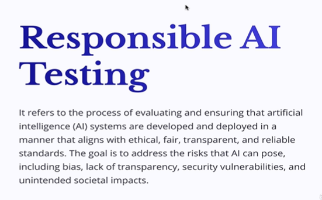
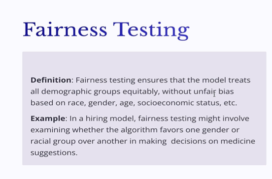
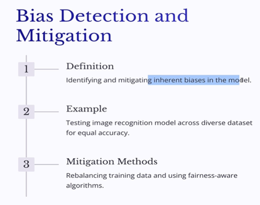
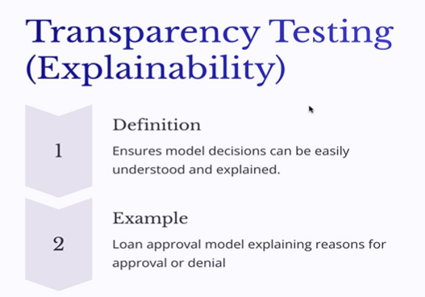
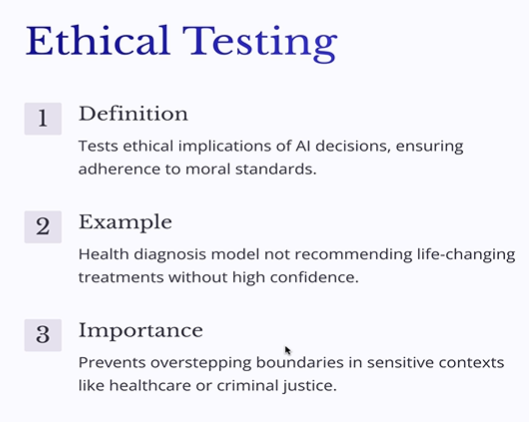

# Responsible AI Testing with Examples on Machine Learning(AI) Models

## Importance of Fairness testing on ML responses to check bias

1. **Responsible AI Testing**

- Ensures ML models are fair, ethical, reliable, transparent and secure.
- Goes beyond functional testing to ensure AI outputs do not negatively impact society.
- Important before deploying models into production.

2. **Fairness Testing**

- Checks whether model predictions are biased towards particular groups based on race, gender, age or socioeconomic status.
- Example: A medical AI trained mainly on data from white patients may provide less accurate recommendations for other racial groups.
- Travel AI should consider different budgets instead of recommending only expensive restaurants.
- Image generation models should produce diverse outputs without consistently favouring one race or gender.

3. **QA Responsibilities**

- Validate model outputs across diverse user groups and datasets.
- Identify and document unfair or biased predictions.
- Share findings with developers.
- Developers can rebalance training data, improve algorithms and release updated models for retesting.

**Key Takeaway:** Responsible AI testing ensures that ML models are not only functionally correct but also fair and ethical. QA plays a key role in detecting bias, documenting it and helping improve model behaviour.

## Transparency testing and why it is necessary to stay ahead in AI competition

> Drive competition with transparency testing and explainability by ensuring AI loan-approval decisions include clear reasons for approval or denial, aligned with financial industry needs.

1. **Transparency Testing (Explainability):**

- Ensures AI outputs are clear, understandable, and explainable to users with different levels of technical knowledge.
- Example: A loan approval model should explain why a loan was approved or rejected, such as a low credit score or missed payments, rather than simply displaying “Loan not approved.”
- Important in financial institutions and school admissions, where customers need understandable reasons behind AI-driven decisions.
- QA verifies the clarity and usefulness of explanations.

2. **Ethical Testing:**

- Ensures AI responses follow ethical boundaries and do not provide harmful, misleading, or inappropriate guidance.
- Example: A medical AI should avoid recommending life-changing treatments without sufficient confidence or giving insensitive responses to critical patients.
- In criminal justice, AI should not generate extreme or unethical recommendations.
- QA tests responses using varied and challenging inputs to identify ethical violations.

3. **Applicability:**

- Not every testing type applies to every AI model. Select testing types based on the model's purpose and business requirements.
- Ethical testing is especially important in healthcare and criminal justice.

**Key Takeaway:** Responsible AI testing ensures that models are explainable, transparent, and ethically responsible within defined business boundaries.