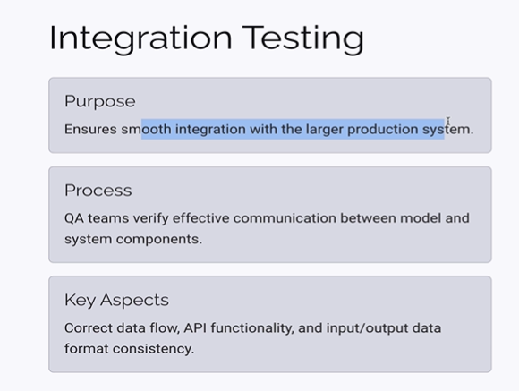
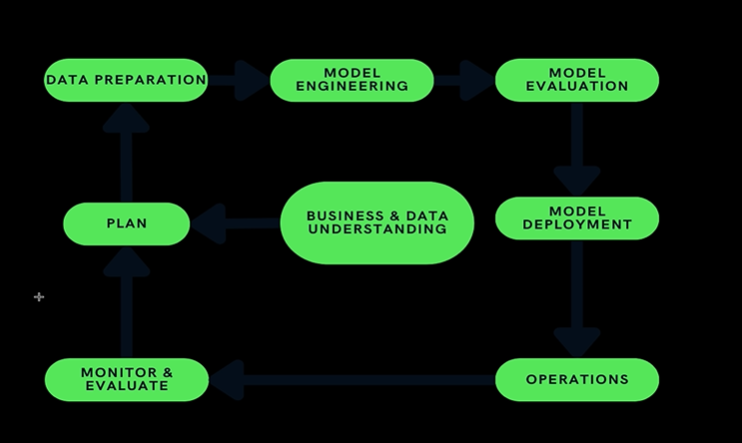
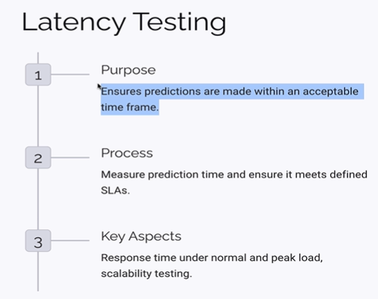
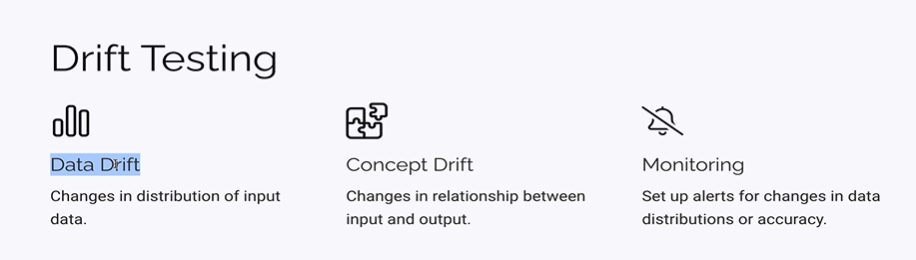
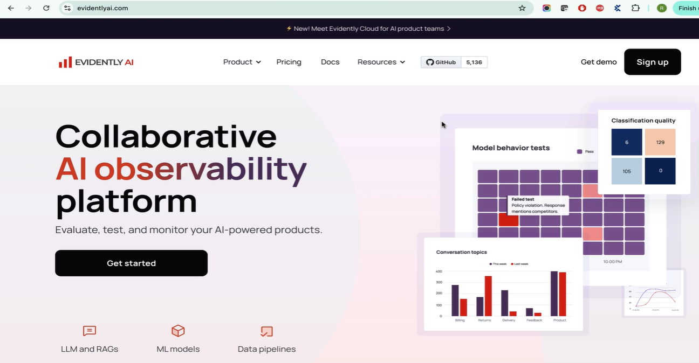
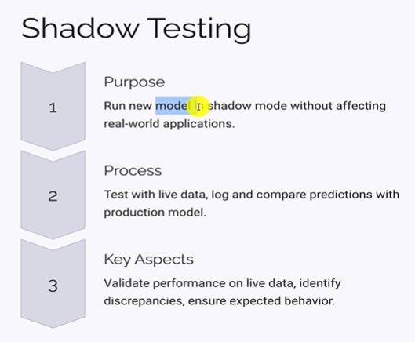
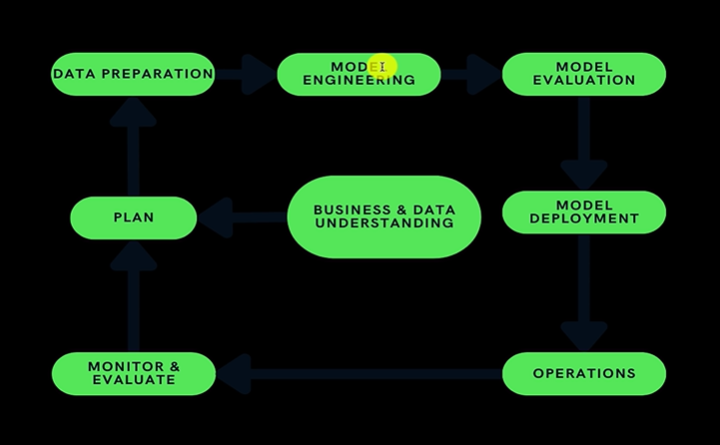
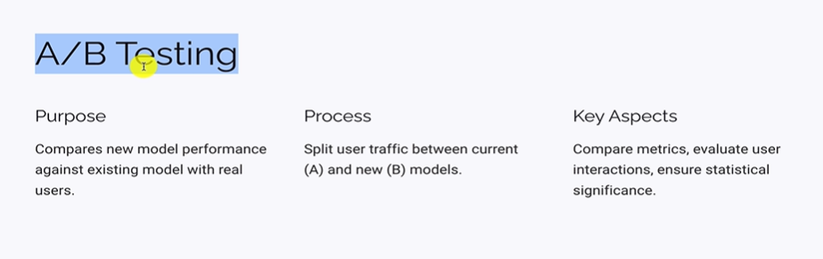
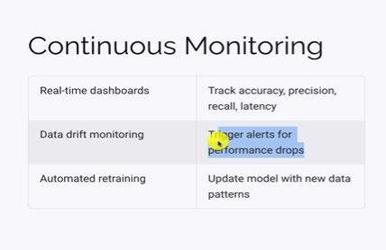

# Post Deployment Testing Types with examples on Machine Learning Models

## Importance of Integration & Latency testing on Production ML models

> Explore integration and latency testing for production ML models, ensuring smooth data flow, API interactions, logs, and metrics, with continuous monitoring and adherence to SLAs.

1. **Deployment Phase:**

- After model training and validation sign-off, the tested model is deployed to production using cloud platforms such as AWS, Azure or Google Cloud.
- DevOps plays a key role in deployment. Once live, production users can access the model.

2. **Production Integration Testing:**

- QA verifies that the deployed model communicates correctly with all production components.
- Check API interactions, input/output formats, backend data flow, logs and statistics collection.
- Perform smoke tests to ensure production integration works as expected.

3. **Monitoring & Evaluation:**

- Continuously collect production data and metrics to understand real-world model behaviour.
- Analyse user inputs and model responses to plan improvements for future model versions.

4. **Latency Testing:**

- Measures how quickly the model generates predictions or responses.
- Validate response times against business-defined SLAs.
- Test during normal and peak traffic periods, considering user locations and usage patterns.
- Example: A free plan may allow 3-second responses, while a premium plan may require 1 second.
- Share performance metrics with the engineering team for optimisation.

**Key Takeaway:** Unlike traditional software QA, ML testing continues after deployment. Production integration, continuous monitoring and latency testing help ensure reliable real-world performance.

## Importance of Data drift Testing & Concept Drift Testing in ML Models

> Understand data drift and concept drift in production machine learning models, and learn to test, monitor, and alert on changing input distributions and input-output relationships.

1. **Drift Testing:**

- Performed during the production Monitoring & Evaluation phase.
- Identifies changes that affect model accuracy and reliability over time.

2. **Data Drift:**

- Occurs when the distribution or pattern of input data changes.
- Example: A medical AI trained on COVID-19 symptoms like fever and sore throat may struggle when newer symptoms emerge.
- QA monitors changing input patterns, identifies outdated training data and reports the need for updated datasets.

3. **Concept Drift:**

- Occurs when the relationship between inputs and expected outputs changes.
- Example: An AI generating Selenium scripts may provide outdated code because Selenium's browser invocation method has changed.
- QA checks whether model outputs still reflect current technologies, rules and real-world conditions.

4. **Monitoring & Tools:**

- Drift can be detected through manual testing or automated monitoring tools.
- Tools compare production inputs and responses against training data and trigger alerts when patterns change.
- Alerts may be false positives, so QA must investigate and validate them before reporting to data/engineering teams.
- Collaborate with DevOps and data teams to understand monitoring tools, configure datasets and analyse alerts.

**Key Takeaway:** Data drift means input patterns change; concept drift means input-output relationships change. QA plays an ongoing role in detecting, investigating and reporting both in production.

## Shadow Testing & A/B Testing to certify the latest version of ML into prod

> Learn how shadow testing and A/B testing certify updated ML models for production, using live data, data drift monitoring, and controlled traffic to compare performance.  

**SELF-NOTES**  

1. **Model Re-engineering:**

- ML models need periodic updates because training data can become outdated.
- Production monitoring and drift detection help identify when new training data is required.
- Updated models must be tested before replacing existing production models.

2. **Shadow Testing:**

- Run the new model silently alongside the existing production model using the same real-time user traffic.
- The new model does not affect actual user responses.
- Compare predictions from both models to identify discrepancies and verify improvements.
- Helps detect issues early before deploying the updated model.

3. **A/B Testing:**

- After successful shadow testing, split production traffic between the existing and new models.
- Example: Send 70% of users to the existing model and 30% to the new model.
- Compare performance, prediction quality, user interactions and feedback.
- Deploy the new model fully only when results demonstrate improvement.

4. **Patch & Minor Releases:**

- If only training data changes and the algorithm remains unchanged, full initial testing may not be necessary.
- Run regression and API tests, along with shadow and A/B testing, before release.

5. **Continuous Monitoring & Retraining:**

- Monitor data drift, concept drift, accuracy and latency using dashboards and tools such as Evidently AI.
- QA analyses alerts and shares metrics with data teams.
- Updated datasets are used for retraining, followed by shadow testing, A/B testing and regression testing.

**Key Takeaway:** ML testing is continuous, not limited to pre-deployment validation. QA remains involved in monitoring, model updates and production releases.
