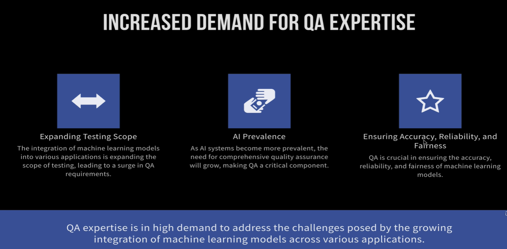
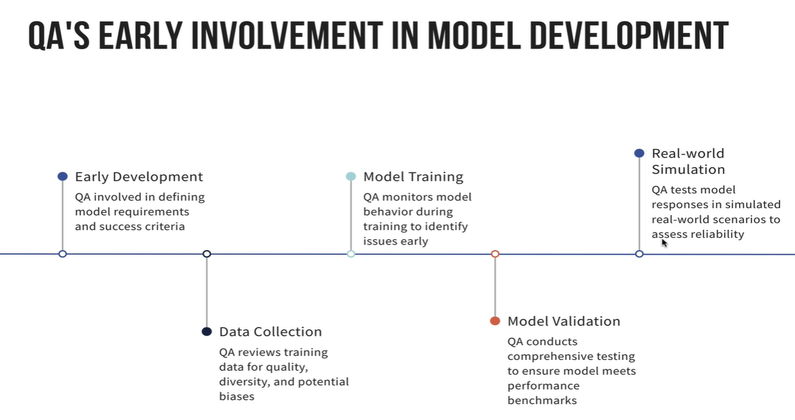
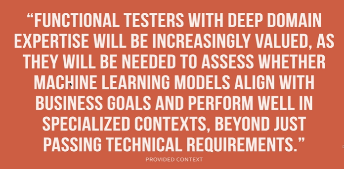

# Final words - Impact of Machine Learning models in QA Space

## How QA's can be critical resources for Machine Learning Model Life cycle

> QA professionals drive machine learning life cycle testing from data gathering to production and monitoring. Prioritize early involvement, domain expertise, and responsible testing including fairness, bias, and drift.

**SELF-NOTES**  

1. **Increasing Demand for QA:**

- AI/ML is expanding the scope of QA rather than eliminating testing jobs.
- Similar to automation testing, new technologies create new testing opportunities and specialisations.
- ML testing goes beyond functional testing to include accuracy, reliability, fairness, bias and Responsible AI testing.

2. **Early QA Involvement:**

- QA should participate from the beginning of the ML lifecycle:
  - Data gathering and collection.
  - Model training and engineering.
  - Model validation and extensive testing.
  - Production monitoring, drift testing and latency testing.
- QA continuously shares feedback with data engineering teams to improve future model versions.

3. **Importance of Domain Expertise:**

- Functional testers with strong domain knowledge will be increasingly valuable in AI/ML projects.
- **Example:** Testing a banking AI requires understanding banking products, mortgage eligibility, credit cards and business rules to validate response accuracy.
- Domain knowledge is especially important for fairness, bias and Responsible AI testing.

**Key Takeaway:** AI/ML testing creates new opportunities for QA professionals. Combining functional testing expertise with strong domain knowledge will be valuable in the evolving AI industry.

> Self-Reminder - Do Proper ML course